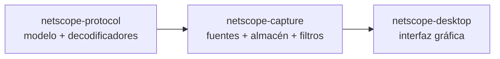
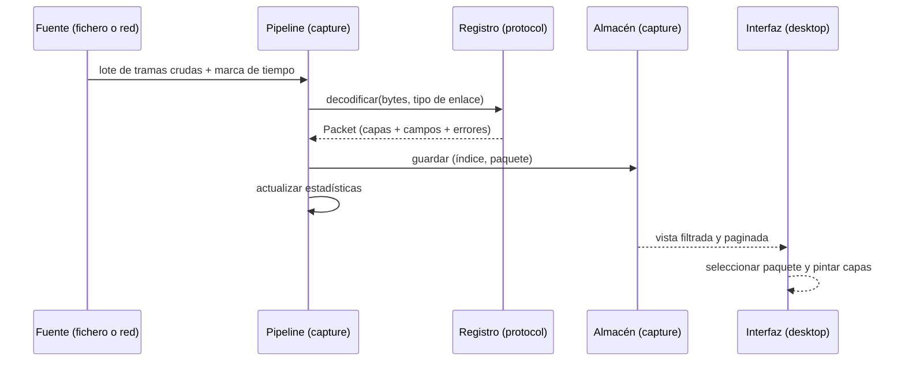

# Arquitectura de NetScope

> Versión 0.1 · borrador para discusión en el Sprint 1 · sin código todavía.

Este documento explica **por qué** el proyecto está organizado así. Las
decisiones que quedan registradas con su contexto están en
[`adr/`](adr/); las firmas concretas entre equipos, en
[`CONTRATOS.md`](CONTRATOS.md).

---

## 1. Principios de diseño

| # | Principio | Qué significa en la práctica |
|---|-----------|------------------------------|
| 1 | **El contrato va primero** | Ningún equipo empieza a implementar hasta que las firmas que consume están escritas en `CONTRATOS.md` |
| 2 | **Las dependencias apuntan en un solo sentido** | `protocol ← capture ← desktop`. Nunca al revés. Si hace falta "al revés", es que el tipo está en el crate equivocado |
| 3 | **Nada de `unsafe`** | Se prohíbe explícitamente con `#![forbid(unsafe_code)]`. Un paquete malformado produce un error, nunca un acceso fuera de rango |
| 4 | **La entrada es hostil por definición** | Toda lectura pasa por un lector con límites comprobados; todo campo de longitud se valida antes de indexar o de reservar memoria |
| 5 | **Los datos no se copian** | Los campos apuntan a la trama mediante rangos (`offset`, `len`). Un paquete con 10 capas cuesta una sola asignación |
| 6 | **Errores informativos, no silenciosos** | Un protocolo desconocido, un paquete truncado o un checksum que no cuadra se muestran; nunca se descartan en silencio |
| 7 | **Extensible por adición** | Un protocolo nuevo es un archivo nuevo + una línea en un registro. Ni `match` gigantes, ni `if` por protocolo repartidos por el código |
| 8 | **La UI no toca bytes** | Toda la información que se muestra ya viene interpretada en el modelo |

---

## 2. Vista de crates



### `netscope-protocol` — Persona B

**Contiene:** el modelo canónico de datos, el registro de decodificadores, el
contrato de decodificación, los decodificadores de protocolo, el volcado
hexadecimal y la reensamblatura de flujos TCP (Sprint 7).

**No contiene:** nada de E/S, nada de sistema operativo, nada de interfaz.

*Por qué:* es el único crate sin dependencias. Si el modelo viviese en `capture`,
la interfaz dependería de la lectura de ficheros para poder pintar un paquete,
y el decodificador de TCP quedaría atrapado detrás de la captura en vivo.

### `netscope-capture` — Persona A

**Contiene:** lectura de PCAP y PCAPNG, captura en vivo, almacén de paquetes con
capacidad limitada, filtros, estadísticas, exportación y el generador de
paquetes de laboratorio.

**No contiene:** interpretación de campos de protocolo. Si `capture` sabe qué es
un número de secuencia TCP, el filtro por protocolo y las estadísticas de bytes
por protocolo dejarían de ser genéricos.

### `netscope-desktop` — Persona C

**Contiene:** estado de la aplicación, lista de paquetes, panel de detalle,
vista de bytes, filtros, estadísticas, exportación y ayuda.

**No contiene:** lectura de ficheros, decisiones de captura ni lógica de
decodificación. La UI compone lo que le dan.

*Por qué:* permite que la interfaz se pruebe con datos sintéticos sin necesidad
de red, y que la captura en vivo se pruebe sin abrir una ventana.

---

## 3. Flujo de datos



Puntos clave:

1. **La fuente solo entrega bytes.** No sabe qué protocolo son. Esto permite que
   leer un fichero y capturar en vivo compartan el 100 % del camino posterior.
2. **El registro decide todo el contenido del modelo.** Nadie más clasifica
   protocolos, ni siquiera los filtros o las estadísticas.
3. **El almacén es el único dueño del estado mutable.** La interfaz solo lee.
4. **La decodificación es una función pura:** mismos bytes, mismo resultado.
   Esto la hace trivial de probar y de repetir.

---

## 4. Modelo de datos

El modelo se define entero en `netscope-protocol` y **no cambia sin ADR**. Resumen:

| Tipo | Qué representa | Notas |
|------|----------------|-------|
| `Packet` | Un paquete: índice, marca de tiempo, longitudes, bytes, capas, errores | Dueño del `Vec<u8>` de la trama |
| `Layer` | Una capa decodificada (Ethernet, IPv4, TCP…) | Protocolo + rango + campos |
| `Field` | Un campo de cabecera | Nombre estático + valor + rango en la trama |
| `ByteRange` | Referencia a bytes de la trama | `slice()` devuelve `Option`, nunca indexa a ciegas |
| `Protocol` | Identidad de un protocolo | Cerrado y conocido; no hay números sueltos fuera del registro |
| `LinkType` | Tipo de enlace de la captura | Ethernet, raw, loopback, SLL |
| `DecodeError` | Un problema encontrado | **No invalida el paquete**: se muestra como aviso |

**Decisión clave: los campos no son `String`.** Un campo es un enum de valores
tipados (`u64`, IPv4, IPv6, MAC, bytes, texto, flags). La interfaz decide cómo
pintarlo; el modelo no sabe nada de colores ni de columnas.

**Decisión clave: el paquete truncado es un paquete, no un error.** Un `.pcap`
guardado con `snaplen` de 96 bytes contiene miles de paquetes truncados. El
analizador tiene que mostrarlos con los campos que sí pudo leer y una marca
visible en los que no.

---

## 5. Concurrencia

```
Hilo de la interfaz ───┐
                       ├──▶ Estado compartido (paquete seleccionado, scroll, filtros)
Hilo de captura ───────┤
                       └──▶ Almacén (bloqueos cortos, nunca largos)
```

- **El hilo de la interfaz** (el que impone `egui`) nunca espera: si la
  decodificación no está lista, dibuja lo que hay y marca "analizando".
- **El hilo de captura** lee de la fuente y entrega lotes por un canal con
  capacidad acotada. Si la interfaz va lenta, la fuente se ralentiza o se
  descartan paquetes con un contador visible; nunca se acumula memoria sin
  límite.
- **El almacén** usa el patrón *doble buffer* o un bloqueo muy corto (obra de
  microsegundos). Está prohibido mantener un bloqueo mientras se decodifica o
  mientras se pinta.
- **La decodificación es independiente de los hilos.** Se puede paralelizar por
  lotes sin cambiar una sola firma.

Objección conocida: un generador de paquetes y la exportación comparten el almacén;
se resuelve con una cola de trabajo, no con un `Mutex` largo. Queda anotado como
deuda técnica a resolver en el Sprint 6.

---

## 6. Manejo de errores

Tres niveles, tres tratamientos:

| Nivel | Ejemplo | Tratamiento |
|-------|---------|-------------|
| **Fatal de fichero** | Cabecera PCAP con número mágico desconocido | Error al abrir; la aplicación sigue viva |
| **Por paquete** | Trama de 9 bytes, longitud declarada imposible | Paquete con aviso; la lista lo muestra con icono |
| **Por paquete, no fatal** | Checksum incorrecto, protocolo desconocido | Se muestra y se anota; nunca se descarta |

Regla: **ningún error de datos puede tumbar la aplicación.** Un fichero de 2 GB
con una trama corrupta en el byte 900.000.000 tiene que abrirse y recorrerse
 entero.

---

## 7. Rendimiento

Presupuestos que se miden en el Sprint 6 y que sirven para decidir qué se
optimiza:

| Operación | Objetivo | Cómo se mide |
|-----------|----------|--------------|
| Abrir un `.pcap` de 100 MB | < 3 s | Prueba de integración con fichero generado |
| Decodificar 1.000.000 de paquetes | < 2 s | Bucle sobre tramas en memoria |
| Filtrar 100.000 paquetes | < 20 ms por cambio de filtro | Prueba de referencia |
| Actualizar la lista con 10.000 paquetes | 60 fps | Medición en la interfaz |
| Uso de memoria con captura en vivo | Acotado al tamaño del almacén | Visible en la barra de estado |

Estrategia, en orden: **evitar trabajo** (no decodificar lo que el filtro
descarta), **no copiar** (rangos en vez de `Vec`), **lotes en vez de unidad**
(leer N tramas por llamada), y solo entonces optimizar el código.

---

## 8. Estrategia de pruebas

| Tipo | Qué cubre | Quién |
|------|-----------|-------|
| Unitarias | Cada decodificador con tramas completas, truncadas y malformadas | B |
| Unitarias | Lector PCAP con ficheros sintetizados byte a byte | A |
| Unitarias | Filtros, almacén y estadísticas con datos conocidos | A |
| Integración | Abrir un `.pcap` real y verificar el número de paquetes y campos | A + B |
| Contrato | Cada equipo verifica que consume lo que el otro promete | los tres |
| Golden | Trama → descripción esperada en JSON; si cambia, el cambio es explícito | B |
| Fuzzing | Entrada arbitraria al parser: no debe haber pánico ni bucle infinito | B (A aporta los ficheros semilla) |
| Manuales | La interfaz se usa de verdad antes de darla por terminada | C |

Regla: **el fuzzing no espera a tener una GUI.** B puede hacer fuzzing de
`protocol` en el Sprint 2 sin ninguna dependencia de A ni de C.

---

## 9. Seguridad del parser

- `#![forbid(unsafe_code)]` en los tres crates.
- Lecturas siempre a través de un lector con rango comprobado: si no cabe,
  devuelve `Option` o error, no indexa.
- Ningún campo de longitud del fichero se usa para reservar memoria sin límites
  superiores raisonnables (`snaplen` máximo, longitud máxima de capa).
- Iteraciones acotadas: máximo de capas por paquete (corta ciclos en el registro
  de decodificadores).
- Los `.pcap` no confiables son el caso normal: las pruebas de fuzzing empiezan en el
  Sprint 2, no al final.

---

## 10. Alternativas consideradas y descartadas

| Alternativa | Por qué no |
|-------------|-----------|
| Un solo crate con módulos | Cualquier cambio de protocolo toca un binario compartido y todos compilan igual. Con tres crates, B no recompila la interfaz y C no recompila el parser |
| `capture` como dueño del modelo | La interfaz dependería de la E/S. Rompe el paralelismo |
| Usar `pcap` de libpcap para todo | Windows y macOS arrastran dependencias del sistema; se reserva para captura en vivo |
| Decodificación en el hilo de la interfaz | Congela la ventana con ficheros grandes |
| Base de datos para el almacén | Demasiado para 100 MB en memoria; `Vec` + índices bastan |
|egui con ECS propio | Complejidad innecesaria; el modelo de datos ya es un árbol |

---

## 11. Deuda técnica aceptada

Se documenta ahora para no olvidarlo:

1. Sin captura en vivo antes del Sprint 6: la UI trabaja con ficheros.
2. Sin reensamblado TCP hasta el Sprint 7: los segmentos se muestran sueltos.
3. Sin IPv6 con cabeceras de extensión hasta el Sprint 4.
4. Sin VLAN: las tramas etiquetadas se marcan como no soportadas.
5. Sin lectura de `pcapng` con múltiples interfaces en el Sprint 2 (se hace en
   el 3).

Cada una tiene su entrada en [`ROADMAP.md`](ROADMAP.md).