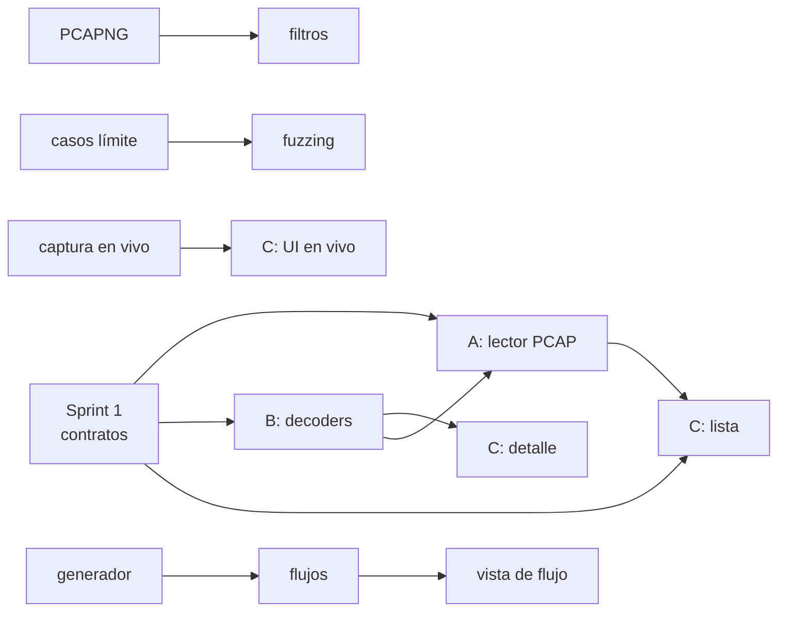

# Roadmap: 8 sprints para tres personas

> 8 sprints × 2 semanas = 16 semanas. Cada persona trabaja en un frente
> independiente. Este documento explica **qué** hace cada quien, **cuándo** y
> **por qué no se bloquean entre ellos**.

---

## 1. Las tres personas

| | Persona A — Captura e ingesta | Persona B — Protocolos | Persona C — Interfaz |
|---|---|---|---|
| **Crate** | `netscope-capture` | `netscope-protocol` | `netscope-desktop` |
| **Pregunta que responde** | ¿De dónde salen los bytes? | ¿Qué significa cada byte? | ¿Cómo se ve? |
| **Su perfil** | PCAP, PCAPNG, hilos, canales, libpcap | Máscaras de bits, endianness, checksum, *fuzzing* | egui, maquetación, estado, coste de pintado |
| **Su entregable estrella** | "Abre este fichero y dame 4.200 paquetes" | "Esto es un campo TTL y está en el offset 8" | "Haz clic y lo ves" |
| **No depende de** | El decodificador de TCP | La captura | La captura |

Cada persona es **dueña y única autora** de los ficheros de su crate. Nadie
edita código ajeno: para cambiar algo del crate de otro se abre una incidencia o
un ADR.

---

## 2. Por qué el paralelismo es real

Tres decisiones del Sprint 1 hacen que nadie espere a nadie:

1. **El DAG es lineal.** B no depende de A, y C depende de B pero no de A.
   Un bloqueo en A no impide avanzar ni a B ni a C.
2. **Los contratos se firman antes de codificar.** C puede escribir su vista de
   detalle contra el modelo definido, aunque no exista un solo decodificador.
3. **Todos tienen datos desde el primer día.** Las fixtures se crean en el
   Sprint 1, no cuando "ya haya algo que capturar".

Además, el trabajo está troceado **por dentro** de cada sprint, no por sprint
completo: es decir, ninguna tarea dura 2 semanas seguidas de otra que tampoco.

---

## 3. El calendario

Cada sprint: 10 días laborables. reserves el lunes para planificación de la
semana y el viernes para integración. Las tres personas entregan algo
**demostrable** el último día, aunque esté a medias.

### Sprint 1 — Cimientos y contratos
*Objetivo del sprint: que nadie esté bloqueado durante los 15 meses siguientes.*

| Persona A | Persona B | Persona C |
|---|---|---|
| Crear el workspace de Cargo con los tres crates y CI mínimo (`fmt`, `clippy`, `test`) | Definir y documentar el modelo: `Packet`, `Layer`, `Field`, `ByteRange`, `Protocol`, `LinkType` | Maqueta de la ventana: tres paneles (lista, detalle, bytes) con datos falsos |
| Escribir `fixtures/` con tramas mínimas escritas a mano (una por protocolo) y su generador mínimo | Redactar los 6 ADR iniciales y las notas de protocolo de [`PROTOCOLOS.md`](PROTOCOLOS.md) | Maquetar la navegación y decidir el flujo: abrir → seleccionar → detalle |
| Redactar la parte de `capture` de [`CONTRATOS.md`](CONTRATOS.md) | Firmar la parte de `protocol` del contrato | Redactar la parte de `desktop` y probar los contratos con dobles |
| **Entregable:** el workspace compila vacío y hay contrato firmado | **Entregable:** modelo escrito y ADR aceptados | **Entregable:** maqueta navegable con datos inventados |

**Hito de integración:** los tres compilan el mismo workspace y la maqueta de C
ya enseña el modelo de B con datos escritos por A.

---

### Sprint 2 — Leer ficheros y entender tramas
*Objetivo: abrir un `.pcap` y ver qué lleva dentro.*

| Persona A | Persona B | Persona C |
|---|---|---|
| Lector PCAP: cabecera global, records, endianness, `snaplen`, validación de longitudes | Ethernet II, IPv4 y UDP completos, con sus pruebas | Lista de paquetes: columnas, selección, desplazamiento, color por protocolo |
| Manejo de errores: fichero corrupto, cabecera inválida, EOF inesperado | Sistema de errores: truncado, malformado, longitud inválida | Mostrar `nº de paquetes`, tamaño y origen en la barra de estado |
| Almacén con capacidad limitada y prueba con un fichero grande | Tests con tramas truncadas en cada longitud crítica | Cargar un fichero de verdad desde disco |
| **Entregable:** la herramienta lista un `.pcap` real con 10.000 paquetes | **Entregable:** Ethernet/IPv4/UDP decodificados y probados | **Entregable:** se abre un fichero y se ve la lista |

**Hito de integración:** abrir un `.pcap` propio y ver Ethernet, IPv4 y UDP con
sus campos.

---

### Sprint 3 — Casos límite y detalle
*Objetivo: que nada de lo raro rompa el programa.*

| Persona A | Persona B | Persona C |
|---|---|---|
| Lector PCAPNG: secciones, interfaces múltiples, comentarios | TCP completo: flags, opciones, ventana, reensamblado *en bruto* | Panel de detalle: árbol de capas y campos con offset |
| Ficheros dañados a propósito (bits cambiados) y recuperación | ARP, ICMP, ICMPv6 | Resaltado del campo seleccionado en la vista de bytes |
| API de filtros: sintaxis de texto y combinadores | Casos límite: fragmentación, longitudes imposibles, checksums | Vista de bytes con volcado hexadecimal y ASCII |
| **Entregable:** lee PCAP y PCAPNG, incluidos ficheros dañados | **Entregable:** TCP y familia ICMP con casos límite cubiertos | **Entregable:** detalle campo a campo con offsets |

**Hito de integración:** el mismo paquete malformado se ve igual en los tres
frentes: A no se cae al leerlo, B lo marca, C lo enseña marcado.

---

### Sprint 4 — Mostrar y medir
*Objetivo: una herramienta usable por una persona que no es del equipo.*

| Persona A | Persona C | Persona B |
|---|---|---|
| Estadísticas: totales, por protocolo, por puerto | Filtros en la interfaz y búsqueda incremental | IPv6 completo, incluidas las cabeceras de extensión |
| Búsqueda en el almacén y paginación | Selección de varios paquetes, copiar al portapapeles | Fuzzing del parser, Publication de las pruebas doradas |
| Pruebas de rendimiento y publicación de las cifras | Atajos de teclado y guardado de preferencias | Checksum de TCP y UDP con pseudo-cabecera |
| **Entregable:** estadísticas y búsqueda | **Entregable:** filtrar y buscar mientras se ve el resultado al instante | **Entregable:** el parser sobrevive a entradas arbitrarias |

**Hito de integración:** cifras de rendimiento publicadas en el README.

---

### Sprint 5 — Pulido de protocolo
*Objetivo: cubrir lo que la gente usa de verdad.*

| Persona A | Persona B | Persona C |
|---|---|---|
| Filtros avanzados: combinaciones, negación, filtros guardados | DNS, DHCP, ICMP con carga útil | Editor de filtros con sugerencias y mensajes claros |
| Exportación de los paquetes seleccionados a `.pcap` | Pruebas doradas de todo lo anterior | Panel de filtros guardados y atajos |
| Soporte de `DLT_NULL` y `DLT_LINUX_SLL` | Revisión de código de los decodificadores por el resto | Mejoras de la lista: columnas configurables, color por regla |
| **Entregable:** exportar una selección | **Entregable:** DNS y DHCP funcionando | **Entregable:** la interfaz se maneja sin explicación |

**Hito de integración:** se exporta un subconjunto y se vuelve a abrir en
Wireshark para comprobarlo (o al revés).

---

### Sprint 6 — Tiempo real
*Objetivo: mirar la red en directo, sin que la interfaz se congele.*

| Persona A | Persona B | Persona C |
|---|---|---|
| Integración con la biblioteca de captura: Linux (libpcap) y Windows (Npcap) | Perfilado y optimización del decodificador | Botones de inicio/parada, selector de interfaz, estado |
| Hilo de captura + canal con lote; nunca bloquear la interfaz | Reensamblado de flujos TCP | Estadísticas en vivo (paquetes/s, bytes/s, distribución) |
| Manejo de pérdida: contador visible, política documentada | Pruebas de rendimiento con 1.000.000 de paquetes | Filtros aplicados en vivo sin perder hilo |
| **Entregable:** captura real de una interfaz | **Entregable:** decodificar 1M de paquetes en el presupuesto | **Entregable:** capturar y ver el tráfico en directo |

**Hito de integración:** 10 minutos de captura real en una red autorizada del
equipo, con la interfaz responding todo el tiempo.

---

### Sprint 7 — Laboratorio y flujos
*Objetivo: entender qué pasa cuando hay más de un paquete.*

| Persona A | Persona B | Persona C |
|---|---|---|
| Generador de paquetes: Ethernet/IPv4/UDP/TCP/ARP con checksums válidos | Reensamblado de flujos: reordenación, retransmisiones, secuencia | Vista de flujo: dos extremos, cronología, bytes |
| Escritura de la captura generada a `.pcap` | Pruebas del generador contra el decodificador (ida y vuelta) | Exportación de flujos y de capturas |
| Modo "laboratorio": generar → capturar → comparar | Pruebas de flujo con capturas de referencia | Ayuda en línea y mensajes de error más amables |
| **Entregable:** generar tráfico controlado en red de laboratorio | **Entregable:** un flujo TCP se lee como una historia | **Entregable:** ver el flujo completo de una conexión |

**Hito de integración:** generar 500 paquetes en una red de laboratorio,
capturarlos, y que la vista de flujo tenga sentido de principio a fin.

---

### Sprint 8 — Cierre
*Objetivo: algo que otra persona pueda clonar y usar.*

| Persona A | Persona B | Persona C |
|---|---|---|
| Empaquetado, publicación de binarios, notas de instalación | Endurecimiento final: entradas adversariales, revisión de errores | Pulido, primeros pasos y recorrido guiado |
| Pruebas de integración de principio a fin | Documentación de protocolos completada y revisada | Grabación o capturas del recorrido |
| Revisión global del código de los tres crates | PR de limpieza y comentarios | Revisión de accesibilidad y textos |
| **Entregable:** `netscope v0.1.0` instalable | **Entregable:** parser listo para usar | **Entregable:** alguien externo lo usa sin ayuda |

**Hito de integración:** publicación de la versión y anuncio en el repositorio.

---

## 4. Dependencias reales entre sprints

**Lo que este grafo dice:** la única dependencia crítica es
`Sprint 1 → todo lo demás`. A partir del Sprint 2, cada persona avanza a su
ritmo y solo se engancha con la anterior en los hitos de integración.

---

## 5. Definición de terminado (por sprint y por persona)

Una tarea está terminada cuando:

- [ ] compila sin avisos (`clippy` limpio);
- [ ] tiene pruebas que fallan si el comportamiento se rompe;
- [ ] tiene al menos un caso de entrada hostil (truncado, vacío, incoherente);
- [ ] no rompe ningún contrato de [`CONTRATOS.md`](CONTRATOS.md);
- [ ] está documentado donde toca (comentarios, notas de protocolo, README);
- [ ] se puede demostrar en menos de dos minutos.

Si una tarea no cumple todo, **no está terminada**, por mucho que funcione en el
portatil de quien la hizo.

---

## 6. Hitos de integración

Al final de cada sprint, las tres personas se sientan 30 minutos y:

1. Cada una demuestra su entregable con la herramienta real, no con capturas de
   pantalla.
2. Se ejecutan las pruebas de contrato cruzadas: A prueba con la API de B, C
   prueba con la API de A y B.
3. Se revisan los tres ADRs nuevos, si los hay.
4. Se decide qué entra en el backlog del sprint siguiente.

**Regla anti-demo:** si el entregable de alguien depende de que otro haya
terminado algo, la integración falla y el culpable es el contrato, no la
persona. Se arregla añadiendo una promesa al documento.

---

## 7. Riesgos

| Riesgo | Probabilidad | Impacto | Mitigación |
|--------|--------------|---------|------------|
| La interfaz se bloquea con ficheros grandes | Alta | Alto | Progreso y lectura por lotes desde el Sprint 2, medido en el 4 |
| Un decodificador entra en bucle con una trama manipulada | Media | Alto | Tope de capas por paquete y *watchdog* en el registro |
| La captura en vivo exige permisos y no se puede probar en el portátil | Alta | Medio | Se desarrolla contra un fichero y una interfaz de *loopback*; los permisos se documentan en el Sprint 6 |
| La biblioteca de captura no compila en los tres sistemas | Media | Alto | Se decide en un *spike* de 2 días antes del Sprint 6, con alternativa manual |
| El modelo de datos resulta insuficiente y hay que cambiarlo | Media | Alto | Se congela en el Sprint 1 con fixtures reales delante; cambiar después exige ADR y migración |
| Alguien se bloquea esperando trabajo del otro | Media | Alto | Revisión semanal de la matriz de dependencias del §3 |
| El alcance crece ("añadamos TLS, VLAN, IPsec...") | Alta | Medio | Lista explícita de "fuera de alcance" en el README; lo nuevo entra solo en el Sprint 9+ |
| Motivación baja en el Sprint 6 (el más técnico) | Media | Medio | El Sprint 6 incluye también interfaz en vivo, que se ve; el trabajo de flujos llega en el 7 |
| Fichero `.pcap` con datos personales subido al repo | Baja | Alto | `.gitignore` con `*.pcap`, revisión antes de añadir fixtures |

---

## 8. Rituales

| Cuándo | Qué | Cuánto |
|--------|-----|--------|
| Lunes | Planificación de la semana: cada quien elige sus 3 tareas | 30 min |
| Diario | Cada quien publica en el canal qué ha hecho y qué le bloquea | asíncrono |
| Miércoles | Revisión informal de código entre dos personas distintas | 30 min |
| Viernes | Integración y demo de los tres | 45 min |
| Fin de sprint | Revisión del alcance, retrospective, ajuste del backlog | 60 min |
| Cuando algo bloquea | Aviso inmediato en el canal: **no esperar a la reunión** | inmediato |

---

## 9. Fuera de alcance

Para que el proyecto termine: TLS, IPsec, IPX, MPLS, VLAN, captura de
archivos de disco, escritura de filtros BPF compilados, modo headless
avanzado, scripting y plugins de terceros.

Si alguno entra en el alcance, se convierte en el Sprint 9 y se sube la barra
del MVP, no se recorta a los otros.

---

## 10. Cómo se mide el éxito

| Momento | Señal de éxito |
|---------|----------------|
| Final del Sprint 3 | Alguien ajeno al equipo abre un `.pcap` y entiende un paquete sin ayuda |
| Final del Sprint 5 | Alguien del equipo encuentra en menos de 2 minutos cualquier campo de un paquete concreto |
| Final del Sprint 6 | Captura en vivo de 10 minutos sin que la interfaz deje de responder |
| Final del Sprint 8 | `v0.1.0` publicada y al menos una persona externa lo ha instalado y usado |

---

## Calendario

Las fechas están calculadas para empezar el **lunes 19 de octubre de 2026** y
duran 8 sprints de dos semanas. Si la fecha de arranque cambia, se ajusta esta
tabla y nada más.

| Sprint | Fechas | Foco | Cae en |
|--------|--------|------|---------|
| 1 | 19 – 30 oct 2026 | Contratos y cimientos | — |
| 2 | 2 – 13 nov 2026 | Leer ficheros y entender tramas | — |
| 3 | 16 – 27 nov 2026 | Casos límite y detalle | — |
| 4 | 30 nov – 11 dic 2026 | Mostrar y medir | — |
| 5 | 14 – 25 dic 2026 | Pulido de protocolo | **Navidad** |
| 6 | 4 – 15 ene 2027 | Tiempo real | **Año Nuevo** |
| 7 | 18 – 29 ene 2027 | Laboratorio y flujos | — |
| 8 | 1 – 12 feb 2027 | Cierre y publicación | — |

⚠️ **El Sprint 5 cae en Navidad y el 6 en Año Nuevo.** Si el equipo es pequeño,
asumid que la última semana de cada uno de esos dos sprints va a ir a media
velocidad, o bajad el alcance de esos sprints de antemano. Es mejor un Sprint 5
con cuatro entregables que uno con seis a medias.
