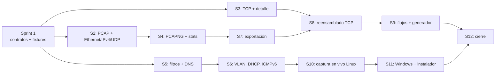

# Roadmap: 12 sprints para tres personas

> **19 de octubre de 2026 – 9 de abril de 2027.** Seis meses, tres personas con
> 15–20 h semanales cada una. El alcance está definido en
> [`ALCANCE.md`](ALCANCE.md); este documento dice **quién hace qué y cuándo**.

---

## 1. Las tres personas

| | A — Captura e ingesta | B — Protocolos | C — Interfaz |
|---|---|---|---|
| **Crate** | `netscope-capture` | `netscope-protocol` | `netscope-desktop` |
| **Pregunta** | ¿De dónde salen los bytes? | ¿Qué significa cada byte? | ¿Cómo se ve? |
| **Su terreno** | PCAP/PCAPNG, hilos, canales, libpcap | Máscaras de bits, endianness, checksum, estados | egui, maquetación, estado, coste de pintado |
| **No depende de** | El decodificador de TCP | La captura | La captura |

Cada persona es **dueña y única autora** de los ficheros de su crate. Nadie
edita código ajeno: para cambiarlo, incidencia o ADR.

La comparación con Wireshark se hace **por categorías de función**, no por
número de protocolos. Ver [`ALCANCE.md`](ALCANCE.md).

---

## 2. Por qué el paralelismo es real

Tres decisiones del Sprint 1 hacen que nadie espere a nadie:

1. **El DAG es lineal.** B no depende de A; C depende de B pero no de A. Un
   bloqueo en A no paraliza a nadie más.
2. **Los contratos se firman antes de codificar.** C escribe su vista de detalle
   contra el modelo definido, aunque no exista un solo decodificador.
3. **Todos tienen datos desde el día 1.** Las fixtures se crean en el Sprint 1.

Y una cuarta, añadida con la experiencia:

4. **Nadie trabaja más de dos sprints seguidos en el mismo pico.** Los picos
   (lectura de ficheros en el 2, captura en vivo en el 10-11, reensamblado en el
   8) están repartidos para que no coincidan.

---

## 3. Calendario

| Sprint | Fechas | Foco | Cae en |
|--------|--------|------|---------|
| 1 | 19 – 30 oct 2026 | Contratos y cimientos | — |
| 2 | 2 – 13 nov 2026 | Leer un `.pcap` y ver sus tramas | — |
| 3 | 16 – 27 nov 2026 | TCP, ARP, ICMP y el detalle campo a campo | — |
| 4 | 30 nov – 11 dic 2026 | PCAPNG, casos límite y estadísticas | — |
| 5 | 14 – 25 dic 2026 | **Navidades: alcance reducido** | 🎄 |
| 6 | 4 – 15 ene 2027 | DNS, DHCP, VLAN, IPv6 extensions | — |
| 7 | 18 – 29 ene 2027 | Filtros a fondo, búsqueda y exportación | — |
| 8 | 1 – 12 feb 2027 | Reensamblado de flujos TCP | — |
| 9 | 15 – 26 feb 2027 | Vista de flujo y generador de laboratorio | — |
| 10 | 1 – 12 mar 2027 | Captura en vivo (Linux) | — |
| 11 | 15 – 26 mar 2027 | Captura en vivo (Windows), instalador y estadísticas | — |
| 12 | 29 mar – 9 abr 2027 | Cierre, binarios portátiles y publicación | — |

⚠️ **El Sprint 5 cae en Navidad.** Va con la mitad de alcance asumido desde el
principio: cuatro entregables, no seis. Es la decisión más barata que hay.

---

## 4. El plan, sprint a sprint

### Sprint 1 — Cimientos y contratos
*Que nadie esté bloqueado durante los meses siguientes.*

| Persona A | Persona B | Persona C |
|---|---|---|
| Firmar el contrato de `capture` | Firmar el contrato de `protocol` | Firmar el contrato de `desktop` |
| Escribir `fixtures/minimos/` a mano y la guía de anonimización | `model.rs`: `Packet`, `Layer`, `Field`, `ByteRange` | `state.rs` sin egui, con sus pruebas |
| `store.rs`, `filter.rs` (sintaxis básica) y `stats.rs` | `decoder.rs`, `registry.rs`, `error.rs` | Maqueta de la ventana con datos falsos |
| Capturar el primer `.pcap` propio y anonimizarlo | Ethernet + IPv4 + UDP de referencia | Colores por protocolo y estados de error |

**Hito:** los tres compilan el mismo workspace y C ya ve el modelo de B con
datos de A.

### Sprint 2 — Abrir un fichero y ver sus tramas
*El momento en que NetScope deja de ser un proyecto.*

| Persona A | Persona B | Persona C |
|---|---|---|
| Lector PCAP propio: cabecera, registros, endianness, `snaplen` | Ethernet II completo con sus casos límite | Lista de paquetes: columnas, selección, desplazamiento |
| Pruebas diferenciales contra `pcap-file` y `tshark` | IPv4: IHL, fragmentación, checksum | Barra de estado: paquetes, bytes, errores |
| Pipeline: fuente → registro → almacén | UDP con checksum y pseudo-cabecera | Abrir fichero de verdad desde disco |
| Filtro por protocolo y por puerto en `pipeline` | Pruebas con el corpus de tramas | Scroll sincronizado con el detalle |

**Hito:** abrir un `.pcap` propio y ver Ethernet, IPv4 y UDP con sus campos,
contrastados campo a campo con `tshark`.

### Sprint 3 — El protocolo interesante y el detalle
*Aquí NetScope empieza a enseñar algo.*

| Persona A | Persona C | Persona B |
|---|---|---|
| Capacidad del almacén y descarte de antiguos | Panel de detalle: árbol de capas y campos con offset | TCP: banderas, opciones, ventana, checksum |
| Medir apertura de un fichero de 100 MB | Vista de bytes con resaltado del campo | ARP e ICMPv4 |
| Pruebas con ficheros dañados a propósito | Copiar al portapapeles en hexadecimal | Casos límite: longitudes imposibles |
| Búsqueda simple en el almacén | Atajos de teclado básicos | Pseudo-cabecera y validación de checksums |

**Hito:** el mismo paquete malformado se ve igual en los tres frentes: A no se
cae al leerlo, B lo marca, C lo enseña marcado.

### Sprint 4 — PCAPNG, límites y estadísticas
*Lo que separa un programa de juguete de uno que se usa.*

| Persona A | Persona B | Persona C |
|---|---|---|
| Lector PCAPNG con `pcap-file` (ADR-0006) | IPv6 con cabeceras de extensión | Estadísticas: totales, por protocolo, caudal |
| Corpus de tramas mutadas como pruebas hostiles | Barrido del corpus hostil completo | Búsqueda incremental |
| Estadísticas por protocolo y por puerto | Pruebas de la cadena completa de capas | Guardado de preferencias |
| Exportar una selección a `.pcap` | Documentación de protocolos completada | Modo claro y oscuro |

**Hito:** cifras de rendimiento publicadas en el README.

### Sprint 5 — Navidad: cuatro entregables, no seis 🎄

| Persona A | Persona B | Persona C |
|---|---|---|
| Filtros con `&&`, `||` y `!` | DNS (cabecera y preguntas) | Filtros en la interfaz con mensajes claros |
| Exportación a CSV | DHCP | Columnas configurables y filtros guardados |
| Pruebas de integración de punta a punta | Pulido y revisión cruzada | Recorrido de uso completo, sin fallos |

### Sprint 6 — Los protocolos que la gente encuentra de verdad

| Persona A | Persona B | Persona C |
|---|---|---|
| Captura de métricas por conversación | VLAN y QinQ: recorrer la cadena de etiquetas | Vista de bytes con colores por tipo de campo |
| Mejora del rendimiento de filtrado | ICMPv6 con mensajes de error | Seguimiento de una conversación UDP |
| Soporte de varios ficheros a la vez | IPv6: casos límite de la cadena de extensiones | Colores y filtros por dirección MAC |

**Hito:** se abre una captura real de tráfico propio y se encuentra algo
concreto usando solo filtros.

### Sprint 7 — Filtros, búsqueda y exportación

| Persona A | Persona B | Persona C |
|---|---|---|
| Filtros guardados, por nombre | Estadísticas por flujo | Panel de estadísticas completo |
| Exportar a CSV y a JSON | Preparar el terreno para los flujos | Exportar selección desde la interfaz |
| Rendimiento del filtrado sobre 100.000 paquetes | Pruebas de estabilidad sobre flujos largos | Historial de filtros y sugerencias |

**Hito:** se exporta un subconjunto y se abre en Wireshark para comprobarlo.

### Sprint 8 — Reensamblado de flujos TCP
*El sprint más difícil del proyecto. Está aquí, no al final, para tener margen.*

| Persona B | Persona A | Persona C |
|---|---|---|
| Seguimiento de números de secuencia | Soporte de secuencias y reordenamiento en el almacén | Vista de dos extremos de una conexión |
| Retransmisiones y datos fuera de orden | Estadísticas por flujo | Cronología de la conexión |
| Capturas que empiezan a mitad | Cierre de conexión y estado | Resaltado de los datos reenviados |
| Pruebas con capturas de referencia | Exportar un flujo | Cantidad de bytes y segmentos |

**Hito:** una conexión TCP completa se lee como una historia, de principio a fin.

### Sprint 9 — Flujos y laboratorio

| Persona A | Persona B | Persona C |
|---|---|---|
| Generador: Ethernet, IPv4, UDP, TCP, ARP | Validar el generador con los decodificadores | Panel del generador: elegir protocolo y opciones |
| Escritura de la captura generada a `.pcap` | Pruebas de ida y vuelta | Generar → capturar → comparar |
| Comparar dos capturas (diferencias) | Extender a DNS y DHCP | Ver el cambio entre dos capturas |

**Hito:** generar 500 paquetes en una red de laboratorio, capturarlos y que la
vista de flujo tenga sentido.

### Sprint 10 — Captura en vivo (Linux)

| Persona A | Persona C | Persona B |
|---|---|---|
| Spike de la biblioteca de captura (ADR-0005) | Botones de inicio y parada, selector de interfaz | Decodificación en segundo plano sin bloquear |
| Backend de Linux detrás del trait | Progreso y paquetes contados en vivo | Tope de capas y manejo de tráfico a gigabits |
| Hilo de captura con canal y lotes | Pausa y reanudación | Decaimiento del almacén en captura larga |
| Mensaje claro cuando faltan permisos | Filtros aplicados en vivo | Pruebas de decodificación con captura real |

**Hito:** 10 minutos de captura real en una red autorizada, con la interfaz
respondiendo todo el tiempo.

### Sprint 11 — Captura en vivo (Windows), instalador y estadísticas

| Persona A | Persona C | Persona B |
|---|---|---|
| Backend de Windows y detección de Npcap | Estadísticas en vivo: paquetes/s, bytes/s | Protocolos nuevos si sobra tiempo |
| **Instalador de Linux** con *capabilities* | Panel de distribución por protocolo | HTTP y TLS si el alcance lo permite |
| Aviso claro en macOS: se lee, no se captura | Ajustes de la interfaz en captura sostenida | Pruebas de regresión de todo el MVP |
| Documentación de instalación por sistema | Mensajes de error por sistema | — |

macOS queda fuera de la captura en vivo (ADR-0007): abrir ficheros sí, capturar
no, con un mensaje que lo explique.

### Sprint 12 — Cierre y publicación
*Que otra persona pueda usarlo sin vosotros.*

| Persona A | Persona B | Persona C | Todos |
|---|---|---|---|
| Binarios portátiles por sistema | Revisión de seguridad del parser | Pulido final y recorrido guiado | Binarios en la sección de releases |
| Notas de instalación por sistema | Endurecimiento ante entradas adversarias | Grabación o capturas del recorrido | Publicación de la v0.1 |
| Pruebas de integración de punta a punta | Documentación de protocolos al día | Revisión de accesibilidad y textos | Retrospectiva y documentación |

**Hito:** v0.1 publicada y al menos una persona externa la ha instalado y usado.

---

## 5. Dependencias reales entre sprints

**Lo que dice este grafo:** la única dependencia fuerte es `S1 → todo`. Entre
el Sprint 2 y el 9, cada persona avanza a su ritmo y solo se engancha con la
anterior en los hitos. Los sprints 10 y 11 son la única zona donde A y C están
juntos, y por eso están seguidos.

---

## 6. Definición de terminado (por sprint y por persona)

Una tarea está terminada cuando:

- [ ] compila sin avisos (`clippy` con `-D warnings` en verde);
- [ ] tiene pruebas que fallan si el comportamiento se rompe;
- [ ] tiene al menos un caso de entrada hostil (truncado, vacío, incoherente);
- [ ] no rompe ningún contrato de [`CONTRATOS.md`](CONTRATOS.md);
- [ ] está documentado donde toca;
- [ ] se demuestra en menos de dos minutos;
- [ ] cabe en su parte del sprint. Si no cabe, **se recorta alcance, no calidad**.

---

## 7. Hitos de integración

Al final de cada sprint, 45 minutos:

1. Cada quien demuestra su entregable con la herramienta real, no con capturas
   de pantalla.
2. Pruebas de contrato cruzadas: A con la API de B, C con la de A y B.
3. Se revisan los ADR nuevos, si los hay.
4. Se decide qué entra en el backlog siguiente.

**Si el entregable de alguien depende de que otro haya terminado**, la
integración falla y el problema es del contrato, no de la persona.

---

## 8. Riesgos

| Riesgo | Probabilidad | Impacto | Mitigación |
|---|---|---|---|
| **El reensamblado TCP se atasca** | Media | Alto | Aislado en los sprints 8-9. Si se cae, cae el flujo y se mantiene todo lo demás |
| **La captura en vivo no arranca por permisos** en Linux o Windows | Media | Medio | Se desarrolla contra ficheros y contra *loopback*; el mensaje de error explica cómo pedir los permisos |
| **La biblioteca de captura no funciona bien en Windows** | Media | Alto | Npcap tiene sus rarezas (permisos, reinicio). El spike del Sprint 10 lo comprueba en Linux y en Windows antes de escribir una línea |
| **Falta la biblioteca de sistema para compilar la GUI** | Baja | Medio | egui y eframe son Rust puro; la dependencia del sistema llega con la captura en vivo, que es opcional |
| **B se convierte en el cuello de botella** | Media | Alto | Los picos no coinciden (§2.4). Si aun así ocurre, el generador pasa a C y el reensamblado al Sprint 13 |
| **El proyecto crece** | Alta | Alto | [`ALCANCE.md`](ALCANCE.md) existe para eso. Lo nuevo entra en el Sprint 13 o no entra |
| **Navidad y el Sprint 5 a media velocidad** | Alta | Bajo | Ya está asumido en el calendario |
| **Un `.pcap` con datos personales sube al repo** | Baja | Alto | Ignorado por `.gitignore`, guía de anonimización en `fixtures/README.md` y checklist en la plantilla de PR |
| **Motivación baja tras el Sprint 8** | Media | Medio | El 9 es creativo (generador y laboratorio) y el 12 publica. Los picos pesados no están seguidos |

---

## 9. Rituales

| Cuándo | Qué | Cuánto |
|---|---|---|
| Lunes | Planificación de la semana: tres tareas por persona | 30 min |
| Diario | Cada quien publica qué ha hecho y qué le bloquea | asíncrono |
| Miércoles | Revisión informal entre dos personas distintas | 30 min |
| Viernes | Integración y demostración de los tres | 45 min |
| Fin de sprint | Alcance, retrospectiva y backlog | 60 min |
| Cuando algo bloquea | Aviso inmediato, **sin esperar a la reunión** | inmediato |

---

## 10. Fuera de alcance

Para que el proyecto termine: TLS, IPsec, IPX, MPLS, filtros BPF compilados,
envío de paquetes, escaneo, captura en disco, plugins de terceros, interfaz web,
scripting y **captura en macOS**.

Si alguno entra en el alcance, se convierte en el Sprint 13 y sube la barra del
MVP, no se recorta a los otros.

---

## 11. Cómo se mide el éxito

| Momento | Señal |
|---|---|
| Final del Sprint 3 | Alguien ajeno abre un `.pcap` y entiende un paquete TCP sin ayuda |
| Final del Sprint 7 | Encuentra en menos de 2 minutos cualquier campo de un paquete concreto, solo con filtros |
| Final del Sprint 9 | Sigue una conexión TCP completa y ve la cronología sin lógica |
| Final del Sprint 11 | Captura 10 minutos en vivo sin que la interfaz deje de responder |
| Final del Sprint 12 | v0.1 publicada y **al menos una persona externa la ha instalado y usado** |