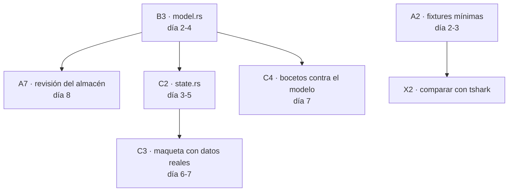

# Sprint 1 · Backlog detallado

> **19 – 30 de octubre de 2026.** Cada tarea tiene identificador, responsable y
> **tamaño estimado** en puntos: **1** = medio día, **2** = un día,
> **3** = dos o tres días.
>
> El Sprint 1 no produce funcionalidad del producto: produce el contrato
> firmado, el modelo de datos, el esqueleto compilando y las primeras fixtures.
> Todo lo que haya en la columna «Llamar a otro» es una dependencia real y hay
> que avisar en cuanto se detecte, no esperar al viernes.

**Presupuesto del sprint:** cada persona tiene unos 10 días laborables, menos las
reuniones. Objetivo: **10-12 puntos** por persona. Más que eso es trabajo de
sobra y el Sprint 2 se retrasa.

---

## Persona A — Captura e ingesta · presupuesto 11 puntos

| # | Tarea | Pts | Depende de | Terminado cuando |
|---|-------|-----|-----------|------------------|
| A1 | Revisar y firmar el contrato de `capture` | 1 | — | La sección está escrita en `CONTRATOS.md` |
| A2 | Escribir 6 tramas mínimas en `fixtures/minimos/` con su comentario | 2 | — | B y C las pueden usar en sus propias pruebas |
| A3 | Capturar un `.pcap` propio y anonimizarlo siguiendo la guía | 1 | A2 | Hay un fichero en `fixtures/reales/` revisado |
| A4 | `store.rs`: índice, capacidad limitada, descarte del más antiguo | 3 | — | 15 pruebas, incluida la de capacidad |
| A5 | `filter.rs`: sintaxis de texto, `!` > `&&` > `||`, errores como mensajes | 3 | A1 | `tcp`, `ip 10.0.0.1`, `port 443`, `src 10.0.0.1:80` y combinaciones |
| A6 | `stats.rs`: totales, por protocolo, caudal | 1 | A1 | Instantánea con valores esperados en una prueba |
| A7 | Revisión del modelo de B contra lo que el almacén necesita guardar | 1 | **B3** | Comentario escrito: «sirve» o «falta X» |

⚠️ **A7 es la primera dependencia real del proyecto.** Si B no tiene `model.rs`
el día 5, A lo escribe y se lo devuelve en el día 6. No bloquea más de un día.

---

## Persona B — Protocolos · presupuesto 11 puntos

| # | Tarea | Pts | Depende de | Terminado cuando |
|---|-------|-----|-----------|------------------|
| B1 | Revisar y firmar el contrato de `protocol` | 1 | — | La sección está escrita en `CONTRATOS.md` |
| B2 | Añadir `interface: Option<u16>` al modelo (punto 5 de la revisión) | 1 | B1 | El campo existe y está documentado |
| B3 | `model.rs`: `Packet`, `Layer`, `Field`, `ByteRange`, `Protocol`, `LinkType` | 3 | B1 | Pruebas de rango, truncamiento y del `Packet` vacío |
| B4 | `error.rs`: `DecodeError` y los niveles de error | 1 | B3 | Se distingue fatal, no fatal y sin efecto |
| B5 | `decoder.rs`: `Reader`, `LayerContext`, el trait `Decoder` | 2 | B3 | Un decodificador de ejemplo funciona en las pruebas |
| B6 | `registry.rs`: qué protocolo corresponde a qué identificador | 1 | B5 | Registro vacío y `standard()`, ambos probados |
| B7 | `layers/ethernet.rs` como implementación de referencia | 2 | B5 | Trama buena, truncada y malformada |

⚠️ **B2 y B3 no se pueden deshacer sin romper a los demás.** Son las dos únicas
tareas del sprint que, una vez terminadas, congelan algo. Si alguien va con
mucho retraso, son las que hay que hacer primero.

---

## Persona C — Interfaz · presupuesto 10 puntos

| # | Tarea | Pts | Depende de | Terminado cuando |
|---|-------|-----|-----------|------------------|
| C1 | Revisar y firmar el contrato de `desktop` | 1 | — | La sección está escrita en `CONTRATOS.md` |
| C2 | `state.rs`: estado de la aplicación, **sin egui**, con sus pruebas | 3 | B3 | Se prueban selección, filtro y paquete visible sin ventana |
| C3 | Maqueta de la ventana con los datos de `fixtures/minimos/` | 2 | C2 | Se ven lista, detalle y bytes con datos reales |
| C4 | Revisar los bocetos de `MOCKUPS.md` contra el modelo de B | 1 | **B3** | Por cada zona, la lista de lo que falta en el modelo |
| C5 | Maqueta de la barra de estado y del mensaje de permisos | 1 | — | Se ve con datos inventados |

⚠️ **C4 es la otra dependencia real.** Los bocetos de `docs/MOCKUPS.md` exigen
cosas concretas del modelo (el offset por campo, el nombre estable, los tres
niveles de error). Si el modelo no las tiene, se sabe el día 4 y no el día 9.

---

## Trabajo compartido · lunes por la tarde

| # | Tarea | Quién |
|---|-------|-------|
| X1 | Reunión de arranque: firmar el contrato | las tres |
| X2 | Plantilla de comparación con `tshark` sobre las fixtures mínimas | A, con B |
| X3 | Primera prueba de contrato cruzada: A consume el registro de B | A |
| X4 | Empezar el backlog del Sprint 2 con una estimación por tarea | las tres |

---

## Dependencias en un vistazo

**El camino crítico es `B3 → (A7, C2, C4)`.** Si `model.rs` se retrasa dos
días, la semana de C se resiente entera. Es lo primero que hay que hacer.

---

## Qué NO entra en el Sprint 1

| Tentación | Por qué no |
|-----------|-----------|
| Leer un `.pcap` de verdad | El Sprint 2 es su turno. Aquí bastan las fixtures mínimas |
| Escribir un decodificador de verdad | Solo `ethernet.rs`, y como referencia de cómo se hace |
| La ventana de verdad | La maqueta con datos falsos enseña lo mismo por una cuarta parte |
| Decidir la biblioteca de captura en vivo | Es del Sprint 10, con el spike de dos días (ADR-0005) |
| Publicar nada en GitHub | El Sprint 12 publica. Ahora solo commits |
| Añadir un cuarto protocolo | Ahora hay dos. El resto llega en el 2, el 3 y el 6 |

---

## El viernes

| Minutos | Qué |
|---------|-----|
| 0-15 | Demostración de los tres: 5 minutos por persona, sin diapositivas |
| 15-30 | Pruebas de contrato cruzadas: A con B, C con A, B con las fixtures |
| 30-40 | Revisión de las 6 decisiones que siguen abiertas (REVISION.md §6) |
| 40-45 | Estimación del Sprint 2 en puntos, uno por persona |

**Lo que se lleva el viernes, además de la demo:**

- [ ] Contrato firmado por los tres
- [ ] `model.rs` congelado y con el campo `interface`
- [ ] Al menos 6 fixtures mínimas
- [ ] `state.rs` con pruebas, sin egui
- [ ] Una captura propia anonimizada en `fixtures/reales/`
- [ ] Las 6 decisiones de `REVISION.md` tomadas o fechadas para decidir
- [ ] El Sprint 2 estimado en puntos por los tres